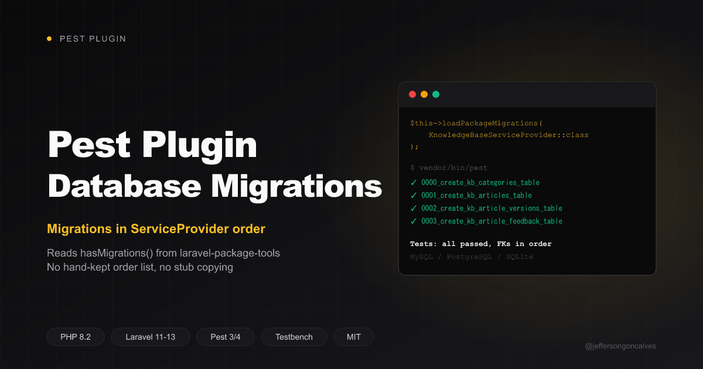

# Pest Plugin Database Migrations

[](https://packagist.org/packages/jeffersongoncalves/pest-plugin-database-migrations)
[](https://github.com/jeffersongoncalves/pest-plugin-database-migrations/actions?query=workflow%3ATests+branch%3Amain)
[](https://github.com/jeffersongoncalves/pest-plugin-database-migrations/actions?query=workflow%3A%22Fix+PHP+code+styling%22+branch%3Amain)
[](https://packagist.org/packages/jeffersongoncalves/pest-plugin-database-migrations)
[](LICENSE.md)

Load a Laravel package's migrations in your tests in the **exact order declared by its
ServiceProvider**. **The provider's `hasMigrations()` list is the truth; the test suite just
reads it.**

Packages built with [`spatie/laravel-package-tools`](https://github.com/spatie/laravel-package-tools)
ship migrations without timestamps, usually as `.php.stub`, and declare the run order in the
provider:

```php
$package->hasMigrations([
    'create_kb_categories_table',
    'create_kb_articles_table',
    'create_kb_article_versions_table',
    'create_kb_article_feedback_table',
    'create_kb_article_relations_table',
    'add_kb_content_localization',
    'add_kb_collections',
]);
```

Laravel's migrator ignores that order and sorts files by name. `create_kb_article_versions_table`
sorts before `create_kb_articles_table` (`_` < `s` in ASCII), which sorts before
`create_kb_categories_table` it references. SQLite doesn't enforce foreign keys at
`CREATE TABLE` time, so the suite passes locally, then breaks on MySQL/PostgreSQL. The usual
fixes are all bad: copying stubs around in `defineDatabaseMigrations()`, or keeping a second,
hand-maintained list of migration names in `TestCase` that drifts every time the package gains
a migration. This package reads the list straight from the ServiceProvider, so there is
nothing to keep in sync.

## Installation

You can install the package via composer:

```bash
composer require jeffersongoncalves/pest-plugin-database-migrations --dev
```

## Usage

### Orchestra Testbench

```php
// tests/TestCase.php
use Illuminate\Foundation\Testing\RefreshDatabase;
use JeffersonGoncalves\KnowledgeBase\KnowledgeBaseServiceProvider;
use JeffersonGoncalves\PestPluginDatabaseMigrations\LoadsPackageMigrations;
use Orchestra\Testbench\TestCase as Orchestra;

abstract class TestCase extends Orchestra
{
    use LoadsPackageMigrations;
    use RefreshDatabase;

    protected function defineDatabaseMigrations(): void
    {
        $this->loadPackageMigrations(KnowledgeBaseServiceProvider::class);
    }
}
```

```php
// tests/Pest.php
uses(Tests\TestCase::class)->in('Feature', 'Unit');
```

### Before / after

What it replaces:

```php
protected function defineDatabaseMigrations(): void
{
    $migrationsPath = __DIR__.'/../vendor/jeffersongoncalves/laravel-knowledge-base/database/migrations';

    if (is_dir($migrationsPath)) {
        foreach (glob($migrationsPath.'/*.php.stub') as $stub) {
            $migrationPath = str_replace('.php.stub', '.php', $stub);

            if (! file_exists($migrationPath)) {
                copy($stub, $migrationPath);
            }
        }

        $this->loadMigrationsFrom($migrationsPath);
    }
}
```

```php
protected function defineDatabaseMigrations(): void
{
    $this->loadPackageMigrations(KnowledgeBaseServiceProvider::class);
}
```

It works the same for a package's own test suite and for an app or package testing against a
dependency installed in `vendor/` — the provider class is all it needs.

### Multiple packages

Providers are loaded in the order you pass them, so a package can be migrated after the one
it depends on:

```php
$this->loadPackageMigrations(
    BaseServiceProvider::class,
    ExtensionServiceProvider::class,
);
```

### Without the trait

```php
use JeffersonGoncalves\PestPluginDatabaseMigrations\PackageMigrations;

// Ordered absolute paths of the declared migration files.
PackageMigrations::files($app, KnowledgeBaseServiceProvider::class);

// Stages them in a temp directory and returns it, ready for loadMigrationsFrom().
PackageMigrations::stage($app, KnowledgeBaseServiceProvider::class);
```

## How it works

1. Instantiates the provider and calls `configurePackage()` to read `migrationFileNames` —
   nothing is registered or booted.
2. Resolves each name to `database/migrations/{name}.php`, falling back to `{name}.php.stub`,
   the same way `laravel-package-tools` does.
3. Copies them to `sys_get_temp_dir()/pest-plugin-database-migrations/<hash>/` as
   `0000_name.php`, `0001_name.php`, … and hands that directory to `loadMigrationsFrom()`.
   Files are only rewritten when their content changes, so parallel test workers don't read
   half-written files, and leftovers from a previous order are removed.

A declared migration that can't be found throws a `RuntimeException` naming the migration
and the provider, instead of silently skipping it.

## Known limitations

- **Only `spatie/laravel-package-tools` providers.** The provider must extend
  `Spatie\LaravelPackageTools\PackageServiceProvider` and declare migrations with
  `hasMigration()`/`hasMigrations()`.
- **`discoversMigrations()` is not supported.** Discovered migrations have no declared order
  to read; load that directory with `loadMigrationsFrom()` directly.
- **Migration names in the `migrations` table get the numeric prefix** (`0001_create_kb_articles_table`).
  Only relevant if a test asserts on those names.

## Testing

```bash
composer test
```

## Changelog

Please see [CHANGELOG](CHANGELOG.md) for more information on what has changed recently.

## Security

If you discover any security related issues, please email the author instead of using the
issue tracker.

## Credits

- [Jefferson Gonçalves](https://github.com/jeffersongoncalves)
- [All Contributors](../../contributors)

## License

The MIT License (MIT). Please see [License File](LICENSE.md) for more information.
